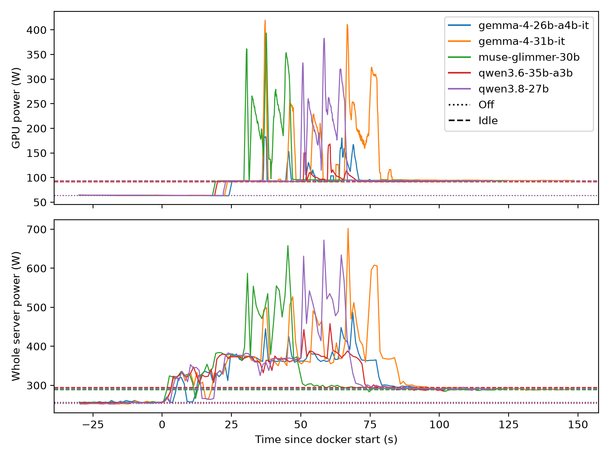
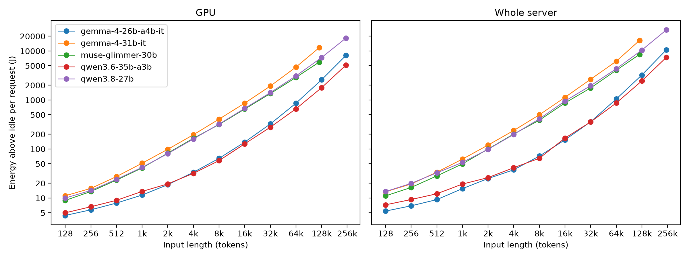
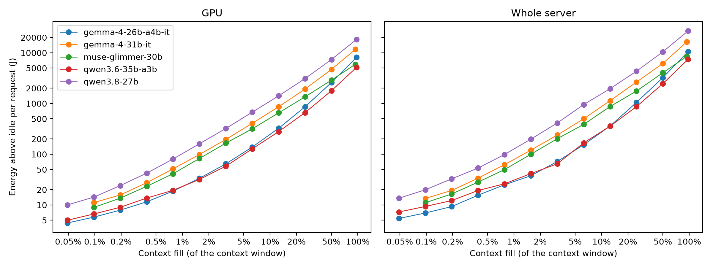
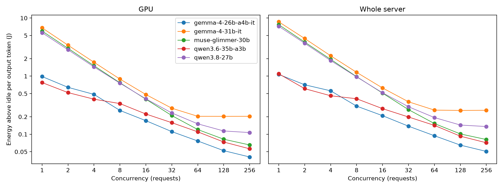
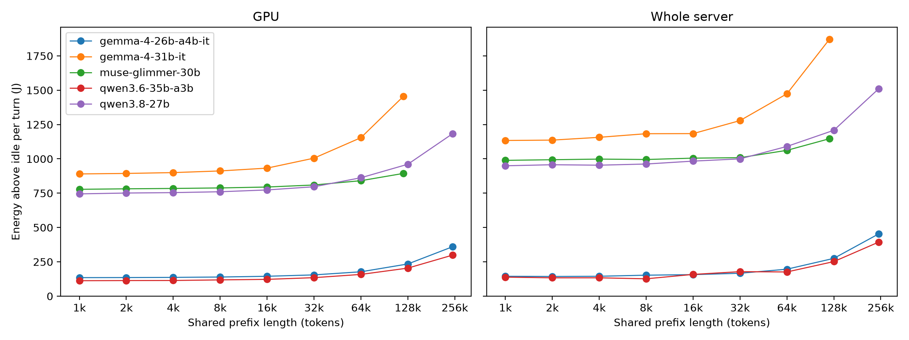

# Report

How much energy does one server use to serve a large language model, and how
does that energy change with the model and the work it is asked to do?

## Summary

We served five open models with vLLM on one H100 GPU: three dense models and
two mixture-of-experts (MoE) models, from three families. We measured the GPU
and the whole server while running three kinds of synthetic traffic. The main
findings, on the GPU:

- **MoE models are far cheaper.** The two MoE models have 3–4B active
  parameters each. Compared with the dense model of the same family, they
  spend 5–6 times less energy per input token, and about 7 times less per
  output token when serving one request at a time.
- **Batching is the biggest lever.** Going from 1 to 256 requests at
  once cuts the energy per output token 14–91 times. At 256 at once the MoE
  models are at most 2.6 times cheaper than the dense ones, apart from
  Gemma 4 31B, which runs short of memory.
- **Long prompts cost more per token, but a cached prefix is cheap.** A
  near-full prompt costs 1.2–3.9 times as much per token as a 4k prompt. In a
  multi-turn conversation, a turn on top of a cached near-full prefix costs
  7–23 times less than reading the same prompt fresh.
- **Keeping any of the models loaded costs 30 W.** Starting a model costs
  1.8–5.0 kJ, so stopping it pays off after 1–3 minutes unused (3–5 minutes
  for the whole server).

Energy is not a fixed amount per token. For the same model it varies up to
90-fold with batching alone. It also depends on the model's architecture,
whether the token is input or output, and what is already cached.

## Why measure this

Systems that route queries between language models, such as the latency-aware
router in [Mind the Delay](https://arxiv.org/html/2607.18253v2), price each
query as a fixed cost per token and leave energy out. This project measures
what energy actually looks like on one edge server, as curves a router or a
planner could use.

## Setup

- One NVIDIA H100 NVL GPU (95 GB), power limit 400 W, in a server shared with
  other services.
- vLLM, one build for every model, with identical settings: each model's
  context window, up to 512 requests at once, prefix caching on, text only, no
  speculative decoding.
- Every model at the precision its publisher releases it in (bf16), so
  quantization never confounds the comparison.

| Model | Family | Type | Parameters | Context window served |
|---|---|---|---|---|
| Qwen3.8-27B | Qwen | dense | 27B | 262,144 |
| Qwen3.6-35B-A3B | Qwen | MoE | 35B, 3B active | 262,144 |
| Gemma 4 31B | Gemma | dense | 31B | 131,072 |
| Gemma 4 26B-A4B | Gemma | MoE | 26B, 4B active | 262,144 |
| Muse Glimmer 30B | Muse | dense | 30B | 131,072 |

We chose models a server of this size would realistically run, at full
precision on one GPU: two families with a dense and an MoE model each, plus a
third family. Gemma 4 31B is served at half its 262,144-token window because the
KV cache for a longer window does not fit on this card.

## How we measured

Two meters ran the whole time, on the same clock:

- **GPU**, 10 times a second, from NVIDIA's management library, which keeps
  its own energy counter.
- **Whole server**, once a second, from the server's management controller.
  It includes CPUs, memory, fans, and the other services on the machine, so
  bursts of their traffic add noise to this meter but not to the GPU's.

Each measured point is one run. Runs went in random order, each starting from
the GPU cooled to the same temperature. Each run records 30 s of the loaded
model at rest (**idle**), then the workload. We report the energy a workload
uses **above its run's idle level**. The GPU sits near its 400 W limit for
most work, so total energy mostly tracks how long the run lasts. The idle
level is paid anyway for as long as the model stays loaded.

| Workload | Varies across runs | Held fixed | Reported per |
|---|---|---|---|
| Prefill | prompt length, 128 tokens to near-full | 1 output token, 1 request at a time | input token |
| Decode | requests at once, 1 to 256 | 128 input and 512 output tokens per request | output token |
| Agentic | shared prefix, 1k tokens to near-full | 20 conversations of 8 turns, 128 tokens in and out per turn, 1 at a time | turn |

- **Prefill** measures reading the prompt.
- **Decode** measures generating output.
- **Agentic** imitates an agent loop. Every conversation starts with the same
  prefix, standing in for a system prompt and tool definitions, and each turn
  resends the whole conversation so far, so the prefix cache serves most of
  each prompt.

"Near-full" is the context window less 8,192 tokens: 253,952, or 122,880 for
the two models served at 131,072. Every model did the same number of requests
at each point. Each point was measured once. In all, 151 runs were recorded
between 18 and 22 November 2026, with no failed requests.

## Results

Energy above idle, at a few points per workload. The figures show every point.

**GPU**

| Model | Decode J/token, 1 at once | Decode J/token, 256 at once | Prefill J/token, 4k prompt | Prefill J/token, near-full | Agentic J/turn, 1k → near-full prefix | Break-even idle |
|---|---|---|---|---|---|---|
| Qwen3.8-27B | 5.6 | 0.11 | 0.039 | 0.073 | 745 → 1,183 | 124 s |
| Gemma 4 31B | 6.8 | 0.20 | 0.048 | 0.095 | 890 → 1,456 | 166 s |
| Muse Glimmer 30B | 6.0 | 0.065 | 0.040 | 0.048 | 778 → 894 | 116 s |
| Qwen3.6-35B-A3B | 0.77 | 0.056 | 0.0078 | 0.020 | 112 → 299 | 63 s |
| Gemma 4 26B-A4B | 0.98 | 0.041 | 0.0082 | 0.032 | 135 → 360 | 78 s |

**Whole server**

| Model | Decode J/token, 1 at once | Decode J/token, 256 at once | Prefill J/token, 4k prompt | Prefill J/token, near-full | Agentic J/turn, 1k → near-full prefix | Break-even idle |
|---|---|---|---|---|---|---|
| Qwen3.8-27B | 7.2 | 0.14 | 0.049 | 0.11 | 949 → 1,510 | 239 s |
| Gemma 4 31B | 8.6 | 0.26 | 0.058 | 0.13 | 1,134 → 1,871 | 312 s |
| Muse Glimmer 30B | 7.7 | 0.081 | 0.049 | 0.069 | 989 → 1,147 | 221 s |
| Qwen3.6-35B-A3B | 1.1 | 0.071 | 0.010 | 0.029 | 138 → 393 | 186 s |
| Gemma 4 26B-A4B | 1.1 | 0.051 | 0.0092 | 0.042 | 145 → 453 | 217 s |

On top of the GPU's energy above idle, the rest of the server adds about a
quarter (median 27%).

### Keeping a model loaded

The GPU draws 64 W with no model loaded and 93.5 W with one loaded and
waiting. The levels are the same, within half a watt, for all five models.
For the whole server they are about 255 W and 288 W.

Starting a model, from starting its container until it answers, took
54–89 s. That costs 1.8–5.0 kJ on the GPU and 7.2–11.2 kJ for the whole
server. Dividing that energy by the 30 W a loaded model costs at rest gives
the break-even time: stopping an unused model saves energy after 1–3 minutes
on the GPU, or 3–5 minutes for the whole server. The MoE models start more
cheaply, so they break even sooner.

### Prefill

The figures show energy per request; the numbers here divide it by the
prompt length.

- **The MoE models read input 5–6 times more cheaply:** 0.008 J per
  token at a 4k prompt, against 0.039–0.048 J for the dense models.
- **Cost per token is U-shaped.** It falls up to about 4–8k tokens, as each
  request's fixed costs spread out. Beyond that it rises, as attention over a
  long context grows.
- **The rise at long prompts differs by model.** At near-full, Qwen3.8-27B
  costs 1.9 times its 4k rate per token and the MoE models 2.6–3.9 times.
  Muse Glimmer barely rises (1.2 times at 122,880 tokens), so the MoE
  advantage narrows at the longest prompts.

The second figure plots the same points against context fill: the prompt's
share of the window the model is served at. Gemma 4 31B's fill is measured
against 131,072 tokens, the window memory allows it on this card, not its
publisher's 262,144.

### Decode

- **One request at a time, the MoE models spend about 7 times less per
  output token** than the dense model of their family: 0.8–1.0 J, against
  5.6–6.8 J for the dense models.
- **The dense models halve their cost per token with each doubling of
  requests, up to about 16.** The dense GPU is already at its 400 W limit with
  one request, so twice the work in the same time costs half as much per
  token. The MoE models start below the limit (260–285 W at one request) and
  climb to it by about 16 requests at once, so their cost per token falls more
  slowly.
- **At 256 at once, the models end up close together:** 0.041–0.056 J per
  token for the MoE models and 0.065–0.11 J for Muse Glimmer and Qwen3.8-27B.
- **Gemma 4 31B stops improving past 64 requests at once,** at 0.20 J per
  token. It is the one model short of KV cache memory on this card. At 256 it
  could only run about 205 requests at once and queued the rest.

### Agentic

- **A turn costs about what its output costs.** A turn with a 1k-token prefix
  is close to 128 output tokens at the one-at-a-time decode rate, for example
  745 J against 128 × 5.6 J = 716 J for Qwen3.8-27B.
- **A longer shared prefix adds modestly per turn.** Growing the
  prefix from 1k to near-full adds 15–64% per turn for the dense models. For
  the MoE models it is 2.7 times, because their turns start so cheap that the
  prefix makes up a larger share.
- **The cache is what makes long agent loops affordable.** A turn on a
  near-full cached prefix costs 7–23 times less than a prefill of the same
  length. For Qwen3.8-27B that is 1.2 kJ per turn against 18.4 kJ to read
  254k tokens fresh.
